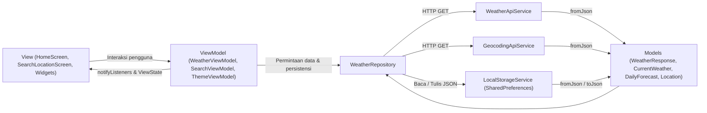
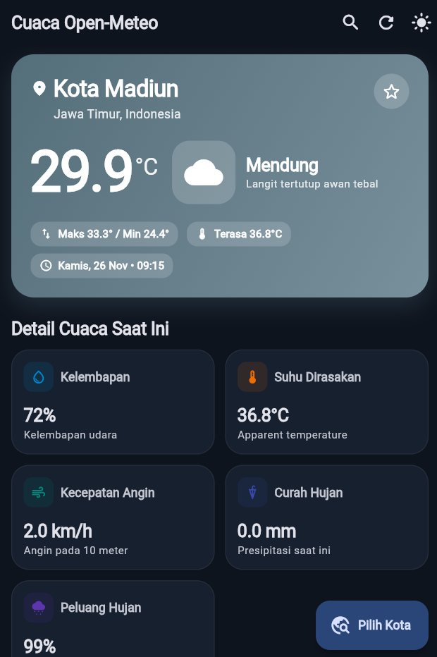
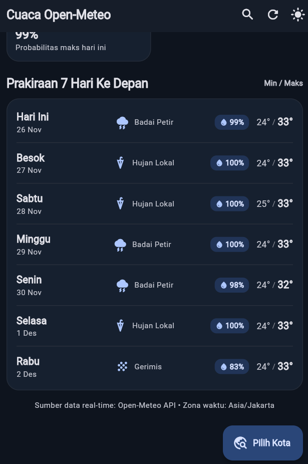
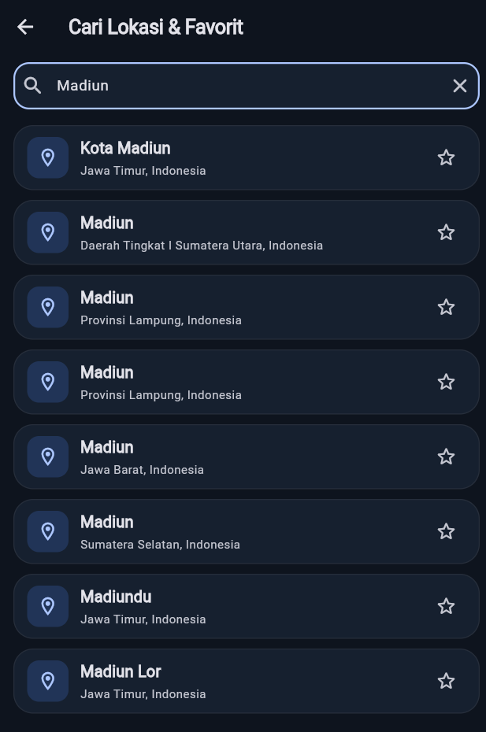
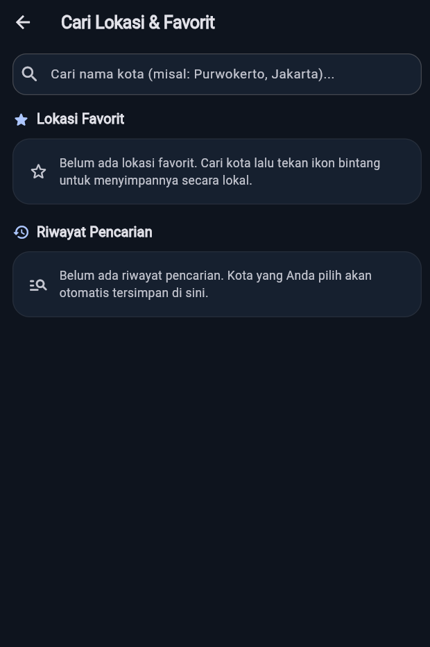
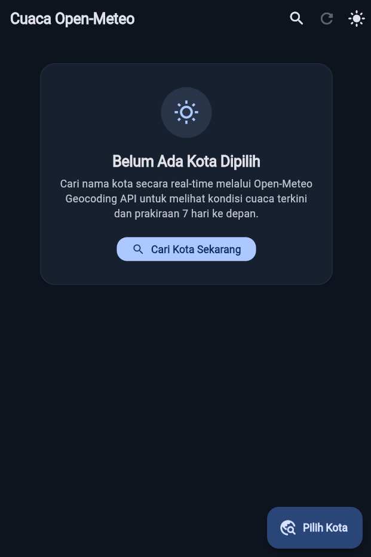
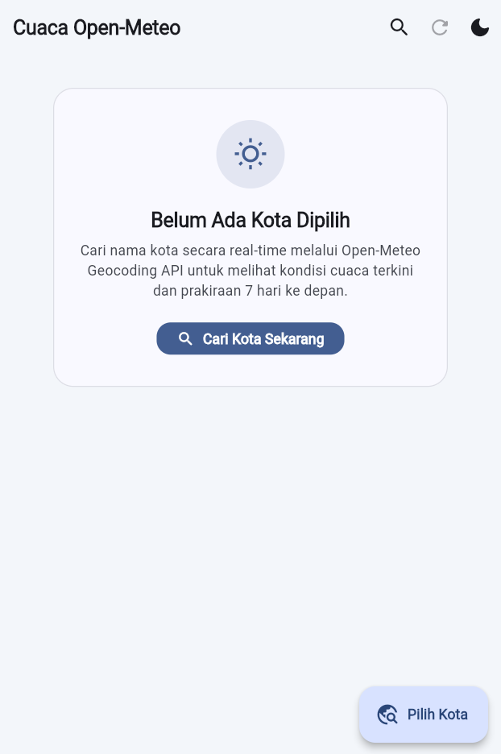

# Aplikasi Prakiraan Cuaca Open-Meteo (Responsi Flutter)

Dokumen ini merupakan dokumentasi teknis resmi untuk proyek **Responsi Flutter** berupa aplikasi prakiraan cuaca berbasis **Flutter (Dart)** yang mengintegrasikan layanan **Open-Meteo REST API** secara *real-time*. Aplikasi ini dirancang menggunakan pola arsitektur **Model-View-ViewModel (MVVM)**, pengelolaan state berbasis **Provider**, antarmuka **Material Design 3** yang responsif, serta penyimpanan lokal persisten menggunakan **SharedPreferences**.

---

## 1. Ringkasan Spesifikasi dan Fungsionalitas

Aplikasi dikembangkan untuk memenuhi seluruh ketentuan teknis berikut:

1. **Bahasa dan Komponen Widget**: Dikembangkan menggunakan Flutter (SDK 3.50.1 / Dart 3.14.0) dengan pemisahan penggunaan `StatefulWidget` (pada layar yang mengelola siklus hidup dan *controller*) serta `StatelessWidget` (pada komponen antarmuka presentasional).
2. **Antarmuka Material Design 3**: Menggunakan `package:material_ui/material_ui.dart` dengan konfigurasi `ThemeData` (`useMaterial3: true`), dukungan mode terang (*Light Mode*) dan mode gelap (*Dark Mode*), skala tipografi (`TextTheme`) yang terstruktur, serta tata letak adaptif berbasis `LayoutBuilder`, `Wrap`, dan `FittedBox` guna mencegah terjadinya *RenderFlex overflow* pada berbagai dimensi layar.
3. **Sumber Data Real-Time**: Seluruh informasi cuaca dan hasil pencarian lokasi diperoleh secara langsung melalui permintaan HTTP `GET` ke layanan Open-Meteo tanpa penggunaan data statis (*hardcoded*).
4. **Layar Utama Minimal**:
   - **Home / Weather Screen**: Menampilkan nama kota terpilih, kondisi cuaca terkini beserta ikon hasil pemetaan kode WMO (`current.weather_code`), suhu aktual (`current.temperature_2m`), informasi cuaca tambahan (kelembapan, suhu yang dirasakan, kecepatan angin, curah hujan, dan peluang hujan maksimum hari ini), serta prakiraan cuaca harian untuk 7 hari ke depan.
   - **Search / Location Screen**: Menyediakan kolom input pencarian kota berbasis Open-Meteo Geocoding API dengan mekanisme *debounce* 450 ms, pemilihan kota untuk segera ditampilkan pada Home Screen, pengelolaan daftar lokasi favorit (simpan/hapus), serta riwayat pencarian yang tersimpan secara lokal.
5. **Penyimpanan Lokal (Local Storage)**: Menggunakan `shared_preferences` untuk menyimpan daftar lokasi favorit, riwayat pencarian, lokasi terakhir yang dipilih, serta preferensi tema. Data yang tersimpan dimuat kembali secara otomatis apabila aplikasi ditutup dan dijalankan ulang.
6. **Penanganan State Jaringan**: Seluruh kondisi operasional jaringan meliputi **Loading**, **Data Kosong (*Empty*)**, dan **Kesalahan (*Error*)** beserta tombol percobaan ulang (*Retry*) ditangani secara terpusat pada antarmuka pengguna.

---

## 2. Struktur Aplikasi

Berikut merupakan susunan direktori dan berkas utama beserta tanggung jawab masing-masing komponen:

```text
ResponsiFlutter_H1D024119/
├── android/
│   └── app/src/main/AndroidManifest.xml       # Konfigurasi izin jaringan INTERNET dan label aplikasi Android
├── macos/Runner/
│   ├── DebugProfile.entitlements              # Konfigurasi izin network client (debug/profile macOS)
│   └── Release.entitlements                   # Konfigurasi izin network client (release macOS)
├── lib/
│   ├── main.dart                              # Titik masuk aplikasi, registrasi MultiProvider, dan lifecycle disposal
│   ├── core/
│   │   ├── constants/
│   │   │   └── api_constants.dart             # Definisi endpoint Open-Meteo, parameter wajib, dan batas timeout
│   │   ├── theme/
│   │   │   └── app_theme.dart                 # Konfigurasi ThemeData Material 3 (Light/Dark) dan skala TextTheme
│   │   └── utils/
│   │       ├── date_formatter.dart            # Pemformatan string tanggal/waktu ISO-8601 ke format Bahasa Indonesia
│   │       └── weather_code_mapper.dart       # Pemetaan kode WMO weather_code (0-99) ke deskripsi, ikon, dan gradien
│   ├── models/
│   │   ├── location_model.dart                # Model lokasi (deserialisasi Geocoding API & serialisasi Local Storage)
│   │   ├── current_weather_model.dart         # Model cuaca saat ini yang memuat 6 field current.* wajib
│   │   ├── daily_forecast_model.dart          # Model prakiraan harian yang memuat 3 field daily.* wajib
│   │   └── weather_response_model.dart        # Model agregat respons lengkap Weather Forecast API
│   ├── services/
│   │   ├── weather_api_service.dart           # Layanan HTTP GET ke Open-Meteo Weather Forecast API (dekode UTF-8)
│   │   ├── geocoding_api_service.dart         # Layanan HTTP GET ke Open-Meteo Geocoding API (dekode UTF-8)
│   │   └── local_storage_service.dart         # Layanan baca/tulis SharedPreferences (favorit, riwayat, lokasi, tema)
│   ├── repositories/
│   │   └── weather_repository.dart            # Abstraksi lapisan data yang mengoordinasikan API dan Local Storage
│   ├── viewmodels/
│   │   ├── view_state.dart                    # Enumerasi state antarmuka (initial, loading, loaded, empty, error)
│   │   ├── weather_viewmodel.dart             # Pengelolaan state cuaca aktif, refresh, proteksi race condition, favorit
│   │   ├── search_viewmodel.dart              # Pengelolaan state pencarian kota real-time dan riwayat pencarian
│   │   └── theme_viewmodel.dart               # Pengelolaan state preferensi mode tema aplikasi
│   └── views/
│       ├── screens/
│       │   ├── home_screen.dart               # Screen 1: Home / Weather Screen (StatefulWidget)
│       │   └── search_location_screen.dart    # Screen 2: Search / Location Screen (StatefulWidget)
│       └── widgets/
│           ├── current_weather_hero.dart      # Kartu ringkasan kota, suhu saat ini, kondisi cuaca, dan tombol favorit
│           ├── weather_metrics_grid.dart      # Grid adaptif informasi cuaca tambahan (5 indikator utama)
│           ├── daily_forecast_section.dart    # Daftar prakiraan 7 hari ke depan dengan mode adaptif layar sempit
│           ├── favorite_chips_bar.dart        # Bilah pintasan lokasi favorit pada Home Screen
│           ├── location_list_tile.dart        # Komponen baris lokasi untuk hasil pencarian, favorit, dan riwayat
│           └── state_feedback_view.dart       # Komponen standar untuk tampilan Loading, Empty, dan Error (+ Retry)
├── screenshots/                               # Direktori penyimpanan berkas tangkapan layar aplikasi
└── test/
    ├── models_and_services_test.dart          # Pengujian unit API (GET, parameter, 9 field, UTF-8) & Local Storage
    └── widget_test.dart                       # Pengujian widget end-to-end (Empty, Search, 9 field, Error/Retry, 320x640)
```

---

## 3. Implementasi API Open-Meteo

Seluruh komunikasi jaringan dilaksanakan menggunakan package `http` dengan metode **`GET`**, dilengkapi dekode eksplisit `utf8.decode(response.bodyBytes)` untuk menjamin keakuratan karakter UTF-8 (seperti simbol derajat `°C` dan nama kota internasional), serta batas waktu tunggu (*timeout*) selama 15 detik.

### 3.1. Open-Meteo Weather Forecast API

- **Metode dan Endpoint**: `GET https://api.open-meteo.com/v1/forecast`
- **Parameter Kueri Wajib**:

| Parameter | Keterangan | Nilai yang Dikirimkan |
| :--- | :--- | :--- |
| `latitude` | Koordinat lintang lokasi terpilih | Diperoleh dari `LocationModel.latitude` |
| `longitude` | Koordinat bujur lokasi terpilih | Diperoleh dari `LocationModel.longitude` |
| `current` | Daftar field cuaca terkini | `temperature_2m,relative_humidity_2m,apparent_temperature,precipitation,weather_code,wind_speed_10m` |
| `daily` | Daftar field prakiraan harian | `weather_code,temperature_2m_max,temperature_2m_min,precipitation_probability_max` |
| `timezone` | Penyesuaian zona waktu otomatis | `auto` |
| `forecast_days` | Rentang hari prakiraan harian | `7` |

### 3.2. Pemetaan 9 Field API Wajib ke Model Dart dan Antarmuka Pengguna

| No. | Informasi Cuaca | Field Open-Meteo API | Properti Model Dart | Komponen Tampilan (View) |
| :-: | :--- | :--- | :--- | :--- |
| 1 | Suhu saat ini | `current.temperature_2m` | `CurrentWeatherModel.temperature2m` | `CurrentWeatherHero` |
| 2 | Kelembapan udara | `current.relative_humidity_2m` | `CurrentWeatherModel.relativeHumidity2m` | `WeatherMetricsGrid` |
| 3 | Suhu yang dirasakan | `current.apparent_temperature` | `CurrentWeatherModel.apparentTemperature` | `WeatherMetricsGrid` & `CurrentWeatherHero` |
| 4 | Curah hujan | `current.precipitation` | `CurrentWeatherModel.precipitation` | `WeatherMetricsGrid` |
| 5 | Kode kondisi cuaca | `current.weather_code` | `CurrentWeatherModel.weatherCode` | `CurrentWeatherHero` (melalui `WeatherCodeMapper`) |
| 6 | Kecepatan angin | `current.wind_speed_10m` | `CurrentWeatherModel.windSpeed10m` | `WeatherMetricsGrid` |
| 7 | Suhu maksimum harian | `daily.temperature_2m_max` | `DailyForecastModel.temperature2mMax` | `DailyForecastSection` & `CurrentWeatherHero` |
| 8 | Suhu minimum harian | `daily.temperature_2m_min` | `DailyForecastModel.temperature2mMin` | `DailyForecastSection` & `CurrentWeatherHero` |
| 9 | Peluang hujan maksimum | `daily.precipitation_probability_max` | `DailyForecastModel.precipitationProbabilityMax` | `DailyForecastSection` & `WeatherMetricsGrid` |

### 3.3. Open-Meteo Geocoding API

- **Metode dan Endpoint**: `GET https://geocoding-api.open-meteo.com/v1/search`
- **Parameter Kueri**: `name=<kata_kunci>&count=10&language=id&format=json`
- **Deserialisasi**: Objek JSON pada array `results` dipetakan menjadi `List<LocationModel>` melalui konstruktor `LocationModel.fromJson`. Apabila kata kunci tidak memiliki kecocokan (Open-Meteo tidak menyertakan key `results`), layanan mengembalikan daftar kosong yang memicu tampilan state *Empty* pada layar pencarian.

### 3.4. Penanganan Kondisi State Jaringan

Setiap eksepsi jaringan (`TimeoutException`, `SocketException`, `http.ClientException`, `FormatException`, serta status HTTP selain `200`) dikonversi menjadi `WeatherApiException` dengan pesan deskriptif dalam Bahasa Indonesia. ViewModel kemudian memetakan kondisi ke enumerasi `ViewState`:

1. **`ViewState.loading`**: Menampilkan indikator pemuatan melalui `StateFeedbackView.loading`.
2. **`ViewState.empty`**: Menampilkan informasi data kosong beserta tombol aksi melalui `StateFeedbackView.empty` (misalnya ketika belum ada kota dipilih pada pembukaan perdana atau pencarian tidak menemukan hasil).
3. **`ViewState.error`**: Menampilkan pesan kegagalan koneksi beserta tombol **Coba Lagi** (*Retry*) melalui `StateFeedbackView.error`.
4. **`ViewState.loaded`**: Menampilkan data cuaca lengkap atau daftar hasil pencarian kota.

---

## 4. Penerapan Arsitektur MVVM (Model-View-ViewModel)

Pemisahan tanggung jawab antar lapisan dirancang secara ketat untuk menjamin keterbacaan, kemudahan pemeliharaan, dan kemudahan pengujian:



1. **Lapisan Model (`lib/models/`)**: Merepresentasikan entitas data yang bersifat *immutable* dan *type-safe*, bertanggung jawab penuh atas konversi struktur JSON ke objek Dart (`fromJson`) dan sebaliknya (`toJson`).
2. **Lapisan Service dan Repository (`lib/services/`, `lib/repositories/`)**:
   - `WeatherApiService` dan `GeocodingApiService` menangani komunikasi jaringan HTTP `GET`.
   - `LocalStorageService` menangani penyimpanan persisten lokal berbasis `SharedPreferences` untuk lokasi favorit (`favorite_locations_v1`), riwayat pencarian (`search_history_v1`), lokasi terakhir dipilih (`last_selected_location_v1`), dan mode tema (`app_theme_mode_v1`).
   - `WeatherRepository` menjadi antarmuka tunggal antara lapisan data dan ViewModel, serta menyediakan metode `dispose()` untuk menutup *HTTP client* secara tertib.
3. **Lapisan ViewModel (`lib/viewmodels/`)**:
   - Mewarisi `ChangeNotifier` dan diinjeksikan melalui `MultiProvider` di `lib/main.dart`.
   - Mengelola seluruh logika bisnis, menyimpan state UI (`ViewState`), serta menerapkan penanda nomor permintaan (`_activeRequestId`) pada `WeatherViewModel` dan `SearchViewModel` untuk mencegah *race condition* apabila pengguna berpindah kota atau mengetik pencarian secara cepat.
   - `WeatherViewModel` berfungsi sebagai sumber kebenaran tunggal (*single source of truth*) bagi daftar lokasi favorit sehingga perubahan status favorit di satu layar langsung tersinkronisasi ke layar lainnya.
4. **Lapisan View (`lib/views/`)**:
   - Hanya bertugas melakukan rendering antarmuka berdasarkan state yang diamati melalui `Consumer` / `Consumer2` dan meneruskan aksi pengguna ke metode ViewModel. Tidak terdapat logika pemanggilan HTTP ataupun penyimpanan lokal secara langsung pada lapisan View.

---

## 5. Prosedur Menjalankan dan Menguji Aplikasi

### 5.1. Prasyarat Lingkungan

- Flutter SDK `>= 3.50.0` dan Dart SDK `>= 3.14.0`.
- Android SDK beserta Android NDK versi `28.2.13676358` (untuk eksekusi pada emulator atau perangkat Android fisik).
- Koneksi internet aktif untuk mengakses Open-Meteo Weather Forecast API dan Geocoding API.

### 5.2. Langkah Eksekusi

1. Mengunduh seluruh dependensi proyek:
   ```bash
   flutter pub get
   ```
2. Menjalankan analisis statis guna memastikan tidak terdapat galat maupun peringatan lint:
   ```bash
   flutter analyze
   ```
3. Menjalankan seluruh pengujian unit dan pengujian widget:
   ```bash
   flutter test
   ```
4. Memeriksa perangkat yang terhubung dan menjalankan aplikasi:
   ```bash
   flutter devices
   flutter run
   ```
   *(Untuk eksekusi khusus pada browser Chrome, gunakan perintah `flutter run -d chrome`. Untuk perangkat Android fisik dengan sistem MIUI/HyperOS, pastikan opsi **USB Debugging** dan **Install via USB** telah diaktifkan pada menu Opsi Pengembang.)*

---

## Video Penjelasan Kode

Video dokumentasi penjelasan kode sumber dan demonstrasi aplikasi dapat diakses melalui tautan berikut:

- **YouTube**: [Video Penjelasan Kode — Aplikasi Prakiraan Cuaca Open-Meteo](https://youtu.be/OfqT7r0yZGg?si=X0isY8w_DciVUIKB)

---

## Screenshots

Berikut merupakan tangkapan layar seluruh layar utama dan kondisi state aplikasi:

| Home / Weather Screen — Cuaca Terkini & Detail | Home / Weather Screen — Prakiraan 7 Hari |
| :---: | :---: |
|  |  |

| Search / Location Screen — Hasil Pencarian API | Search / Location Screen — Daftar Tersimpan Kosong |
| :---: | :---: |
|  |  |

| Search / Location Screen — Kota Tidak Ditemukan | Home Screen — Kondisi Kosong (Mode Gelap) |
| :---: | :---: |
|  |  |

| Home Screen — Kondisi Kosong (Mode Terang) |
| :---: |
|  |
